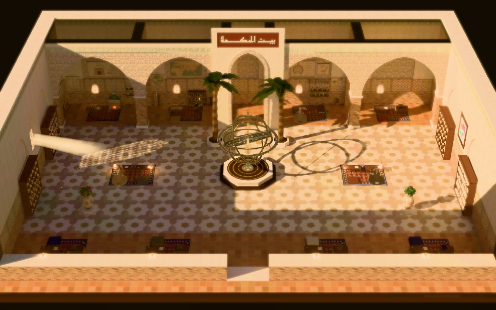
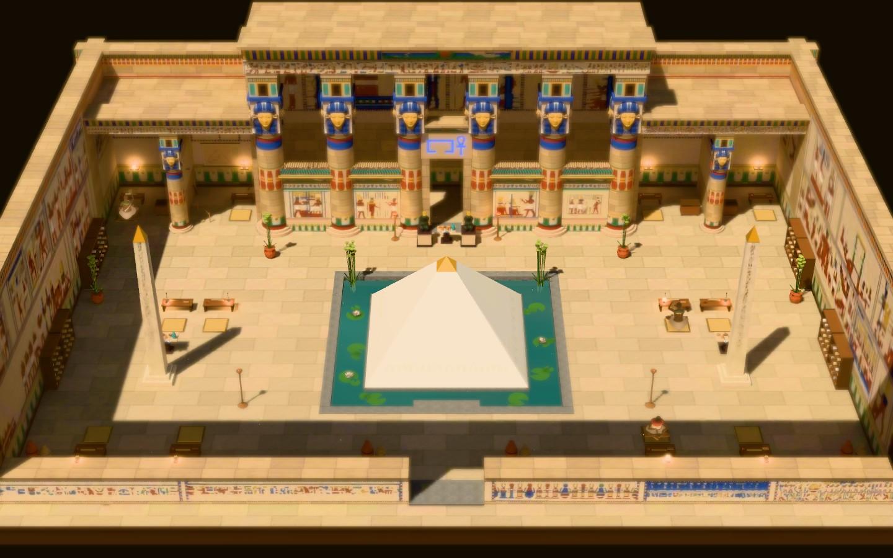

<h1 align="center">Diwan</h1>

<p align="center"><strong>Houses of knowledge for your AI agents.</strong><br/>
Every Claude Code session on your machine becomes a scholar at work in a living diorama of history's great
houses of learning.</p>

<p align="center">by <a href="https://jservo.com">J. SERVO</a></p>

<p align="center">
  
  
</p>

In the Abbasid state the _dīwān_ was the bureau where the empire's work got done: literally "the office". Diwan
is that office for your AI agents.

- **Live mode:** it watches every Claude Code session on your machine and shows each one as a scholar:
  - reading, writing, running commands or searching, at its desk;
  - handing work to apprentices;
  - and, when it needs your approval, lighting a lamp and calling you over.
- **Steer mode:** it can also launch sessions of its own and let you approve, deny and guide them from the
  hall.

## The worlds

| World                            | Setting                                                  | Centrepiece                                                                                               |
| -------------------------------- | -------------------------------------------------------- | --------------------------------------------------------------------------------------------------------- |
| **House of Wisdom** (بيت الحكمة) | Baghdad, 9th century, Abbasid                            | A turning armillary sphere set to Baghdad's latitude; chambers for chemistry, cartography and biology     |
| **House of Life** (𓉐𓋹, _pr-ꜥnḫ_) | A Ptolemaic temple in the Dendera manner, c. 50 BC–AD 30 | A gold-capped pyramid in the pool of Nun; Hathor columns; walls of relief traced from 19th-century plates |

The worlds share one grammar, so a glance tells you who is working, on what kind of task, and who needs you.
Each world has its own "needs you" colour: cobalt in the House of Wisdom, amethyst in the House of Life.
Switch worlds from the HUD.

## Features

- **The live hall:**
  - every session on the machine, with session titles;
  - silent sessions retire on their own;
  - quiet terminal output.
- **Click to inspect:** a scholar's full current action, what it wants approved, its last actions and its
  apprentices. Secrets are redacted before anything leaves the server.
- **Steer mode** (`diwan --steer`):
  - launch a session in a registered project with an exact model, effort level and token budget;
  - approve or deny tool calls in the hall;
  - send follow-ups, interrupt or stop;
  - read replies;
  - every action is written to an audit log.
- **A promo camera:** a scripted, frame-stepped camera (`?promo=main`) and an offline renderer that produces
  smooth MP4s.

## Quick start (from source)

```bash
npm install
npm run build:diwan      # bundles the server and builds the hall
npm run diwan            # or `npm link` once, then just `diwan`
```

- **Starting:** `diwan` serves the hall on `http://127.0.0.1:3200/` (loopback only; `--port N` to change it)
  and opens your browser.
- **Without hooks:** the hall still follows sessions from their transcripts, but approvals show up about 7 s
  late.
- **For instant approvals and session ends,** install Diwan's own Claude Code hooks:

  ```bash
  diwan hooks install      # adds Diwan's entries to ~/.claude/settings.json (with a backup)
  diwan hooks status
  diwan hooks uninstall    # removes only Diwan's entries
  ```

**Steer mode** launches Claude Code sessions of its own, through the Claude Agent SDK, with your own login:

```bash
diwan projects add ~/path/to/project   # lists what the folder's own Claude settings can do, asks to confirm
diwan --steer
```

Sessions started elsewhere stay watch-only. Diwan approves nothing by itself, with one exception: launched
sessions' web searches are auto-approved. Anything you leave unanswered is denied after 15 minutes.

## Security

- **The server:** binds to `127.0.0.1` and rejects foreign `Host` and `Origin` headers.
- **Watch mode is read-only:** the hall can't change anything.
- **Steer mode:** needs a per-run token served only to the page, an exact Origin, and schema-validated
  messages. The hall is never framed (CSP `frame-ancestors 'none'`). Approval cards show the command exactly
  as it will run.
- **Redaction:** commands, labels and logs have secrets masked before they leave the server.

## Development

```bash
cd webview-3d
npm run dev              # the hall on :5180 (demo: ?demo=1)
npm test                 # unit tests
npm run e2e              # Playwright end-to-end tests
npm run perf             # frame-time benchmark (budget: p95 ≤ 8 ms)
npm run promo -- --cut main --format both   # render the promo video
```

- **Rebaking a world** needs Blender 5.2 (`DIWAN_WORLD=house-of-life npm run assets`).
- **Baked outputs** live in `webview-3d/assets/worlds/<world>/out/`. That folder is git-ignored, so add them
  with `git add -f`.
- From the repo root: `npm run check-types` and `npm run test:server`.

## Credits

- **Pixel Agents:** Diwan began as a fork of [Pixel Agents](https://github.com/pixel-agents-hq/pixel-agents) by
  Pablo De Lucca, under the MIT licence; see [NOTICE.md](NOTICE.md). The upstream VS Code extension and 2D
  office are still in the tree (`adapters/vscode`, `webview-ui`).
- **Fonts:** Reem Kufi and Noto Sans Egyptian Hieroglyphs, both under the SIL Open Font License.
- **The House of Life's reliefs and columns:** traced from public-domain plates of the _Description de
  l'Égypte_ (1809–1829). Sources are in `webview-3d/assets/worlds/house-of-life/refs/SOURCES.md`.
- **Animation clips:** Quaternius (CC0).

## Licence and trademarks

- **Code:** MIT, see [LICENSE](LICENSE).
- **Trademarks:** the J. SERVO name and mark are trademarks of J. SERVO LLC and are not covered by the MIT
  licence.
- **Anthropic:** Claude and Claude Code are trademarks of Anthropic. Diwan is an independent project, not
  affiliated with or endorsed by Anthropic.
