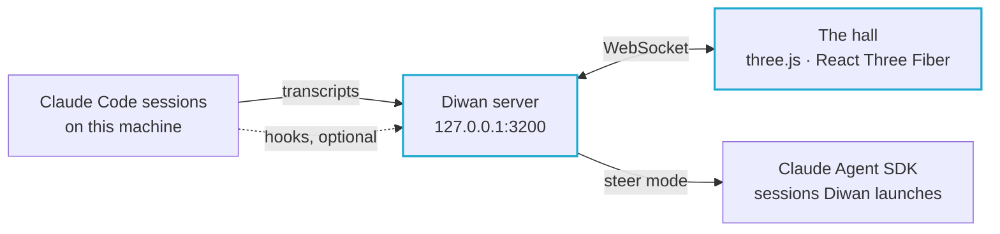

<div align="center">


# Diwan

**Houses of knowledge for your AI agents.**

Every Claude Code session on your machine becomes a scholar at work<br>
in a living diorama of history's great houses of learning.


[](https://github.com/pixel-agents-hq/pixel-agents)
[](LICENSE)

[The Worlds](#the-worlds) · [Features](#features) · [Quick Start](#quick-start) · [How It Works](#how-it-works) · [Security](#security) · [Development](#development)

</div>

<br>

<p align="center">
  
  
</p>

> [!NOTE]
> Diwan is a fork of the MIT-licensed [Pixel Agents](https://github.com/pixel-agents-hq/pixel-agents) by Pablo De Lucca, forked at upstream commit `d1e007a`. The inherited code stays under the MIT License; see [Licence and Trademarks](#licence-and-trademarks).

In the Abbasid state the _dīwān_ was the bureau where the empire's work got done: literally "the office". Diwan is that office for your AI agents.

- **Live mode.** It watches every Claude Code session on your machine and shows each one as a scholar: reading, writing, running commands or searching at its desk; handing work to apprentices; and, when it needs your approval, lighting a lamp and calling you over.
- **Steer mode.** It can also launch sessions of its own and let you approve, deny and guide them from the hall.

## The Worlds

| World                            | Setting                                                  | Centrepiece                                                                                               |
| -------------------------------- | -------------------------------------------------------- | --------------------------------------------------------------------------------------------------------- |
| **House of Wisdom** (بيت الحكمة) | Baghdad, 9th century, Abbasid                            | A turning armillary sphere set to Baghdad's latitude; chambers for chemistry, cartography and biology     |
| **House of Life** (𓉐𓋹, _pr-ꜥnḫ_) | A Ptolemaic temple in the Dendera manner, c. 50 BC–AD 30 | A gold-capped pyramid in the pool of Nun; Hathor columns; walls of relief traced from 19th-century plates |

The worlds share one grammar, so a glance tells you who is working, on what kind of task, and who needs you. Each world has its own "needs you" colour: cobalt in the House of Wisdom, amethyst in the House of Life. Switch worlds from the HUD.

## Features

- **The live hall.** Every session on the machine, with session titles. Silent sessions retire on their own, and terminal output stays quiet.
- **Click to inspect.** A scholar's full current action, what it wants approved, its last actions and its apprentices. Secrets are redacted before anything leaves the server.
- **Steer mode** (`diwan --steer`). Launch a session in a registered project with an exact model, effort level and token budget; approve or deny tool calls in the hall; send follow-ups, interrupt or stop; read replies. Every action is written to an audit log.
- **A promo camera.** A scripted, frame-stepped camera (`?promo=main`) and an offline renderer that produces smooth MP4s.

## Quick Start

From source:

```bash
npm install
npm run build:diwan      # bundles the server and builds the hall
npm run diwan            # or `npm link` once, then just `diwan`
```

`diwan` serves the hall on **http://127.0.0.1:3200/** (loopback only; `--port N` to change it) and opens your browser.

> [!TIP]
> Without hooks the hall still follows sessions from their transcripts, but approvals show up about 7 s late. Install Diwan's own Claude Code hooks for instant approvals and session ends.

<details>
<summary><b>Hooks</b>: install, check, remove</summary>

<br>

```bash
diwan hooks install      # adds Diwan's entries to ~/.claude/settings.json (with a backup)
diwan hooks status
diwan hooks uninstall    # removes only Diwan's entries
```

</details>

<details>
<summary><b>Steer mode</b>: register a project, launch sessions</summary>

<br>

Steer mode launches Claude Code sessions of its own, through the Claude Agent SDK, with your own login:

```bash
diwan projects add ~/path/to/project   # lists what the folder's own Claude settings can do, asks to confirm
diwan --steer
```

Sessions started elsewhere stay watch-only. Diwan approves nothing by itself, with one exception: launched sessions' web searches are auto-approved. Anything you leave unanswered is denied after 15 minutes.

</details>

## How It Works



Diwan keeps Pixel Agents' server, session detection and front-end state engine, and replaces the 2D office with a 3D hall drawn in three.js through React Three Fiber. Each world is a skin over the same engine. Its materials are baked offline in Blender and loaded as KTX2 textures.

## Security

- **The server** binds to `127.0.0.1` and rejects foreign `Host` and `Origin` headers.
- **Watch mode is read-only:** the hall can't change anything.
- **Steer mode** needs a per-run token served only to the page, an exact Origin, and schema-validated messages. The hall is never framed (CSP `frame-ancestors 'none'`). Approval cards show the command exactly as it will run.
- **Redaction:** commands, labels and logs have secrets masked before they leave the server.

## Development

```bash
cd webview-3d
npm run dev              # the hall on :5180 (demo: ?demo=1)
npm test                 # unit tests
npm run e2e              # Playwright end-to-end tests
npm run perf             # frame-time benchmark (budget: p95 ≤ 8 ms)
npm run promo -- --cut main --format both   # render the promo video
```

- **Rebaking a world** needs Blender 5.2 (`DIWAN_WORLD=house-of-life npm run assets`).
- **Baked outputs** live in `webview-3d/assets/worlds/<world>/out/`. That folder is git-ignored, so add them with `git add -f`.
- From the repo root: `npm run check-types` and `npm run test:server`.

| Document                                                                            | What it covers                                                                  |
| ----------------------------------------------------------------------------------- | ------------------------------------------------------------------------------- |
| [webview-3d/README.md](webview-3d/README.md)                                        | Running the hall, live and in demo mode                                         |
| [architecture-notes.md](docs/architecture-notes.md)                                 | The code map: what Diwan keeps from Pixel Agents and where the 3D hall plugs in |
| [History worlds design](docs/superpowers/specs/2026-10-12-history-worlds-design.md) | The worlds, the rendering decisions and the open questions                      |
| [NOTICE.md](NOTICE.md)                                                              | Upstream credit and non-affiliation                                             |

## Credits

- **Pixel Agents:** Diwan began as a fork of [Pixel Agents](https://github.com/pixel-agents-hq/pixel-agents) by Pablo De Lucca, under the MIT licence; see [NOTICE.md](NOTICE.md). The upstream VS Code extension and 2D office are still in the tree (`adapters/vscode`, `webview-ui`).
- **Fonts:** Reem Kufi and Noto Sans Egyptian Hieroglyphs, both under the SIL Open Font License.
- **The House of Life's reliefs and columns:** traced from public-domain plates of the _Description de l'Égypte_ (1809–1829). Sources are in `webview-3d/assets/worlds/house-of-life/refs/SOURCES.md`.
- **Animation clips:** Quaternius (CC0).

## Licence and Trademarks

- **Code:** proprietary, Copyright (c) 2026 J. SERVO LLC, all rights reserved; see [LICENSE](LICENSE).
- **Forked from an MIT project:** Diwan is a fork of [Pixel Agents](https://github.com/pixel-agents-hq/pixel-agents) (MIT, Copyright (c) 2026 Pablo De Lucca), forked at upstream commit `d1e007a`. The parts that come from it stay under the MIT License, whose full text is kept in [LICENSE](LICENSE).
- **Trademarks:** the J. SERVO name and mark are trademarks of J. SERVO LLC.
- **Anthropic:** Claude and Claude Code are trademarks of Anthropic. Diwan is an independent project, not affiliated with or endorsed by Anthropic.

---

<div align="center">
<sub>Built by <a href="https://jservo.com"><b>J. SERVO LLC</b></a> · © 2026 J. SERVO LLC. All rights reserved. Forked from <a href="https://github.com/pixel-agents-hq/pixel-agents">Pixel Agents</a> (MIT); see <a href="LICENSE">LICENSE</a>.</sub>
</div>
