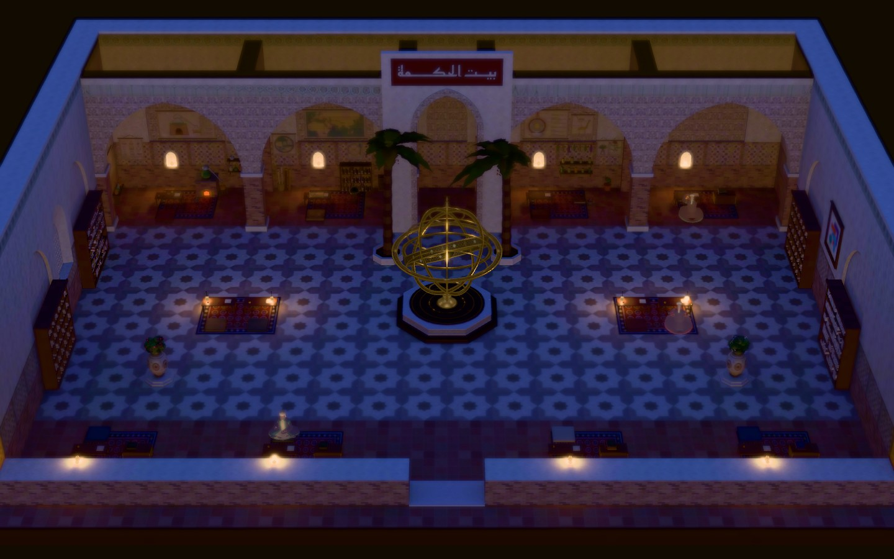
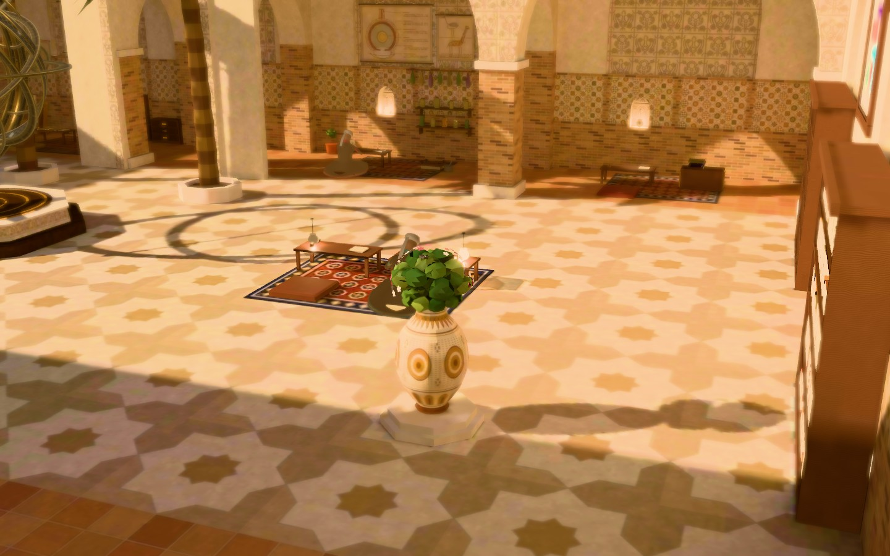
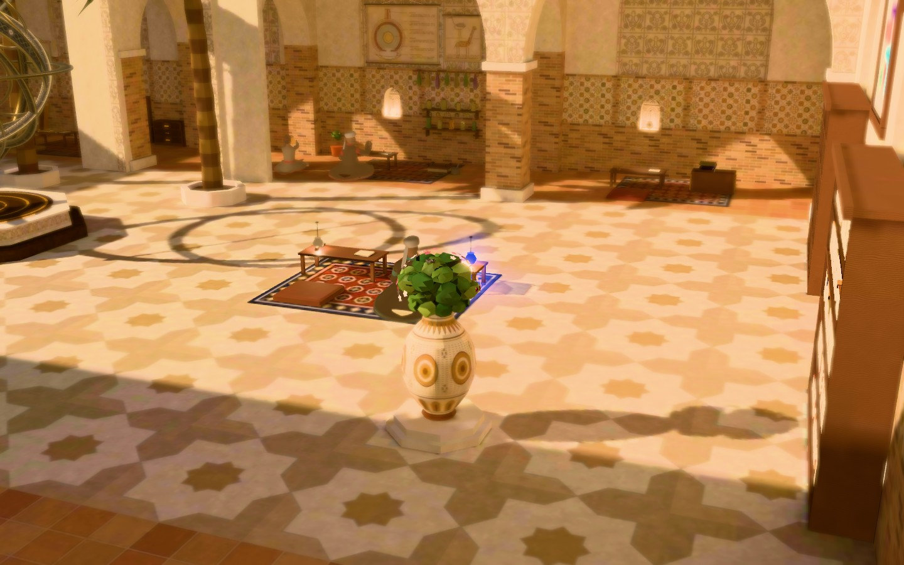
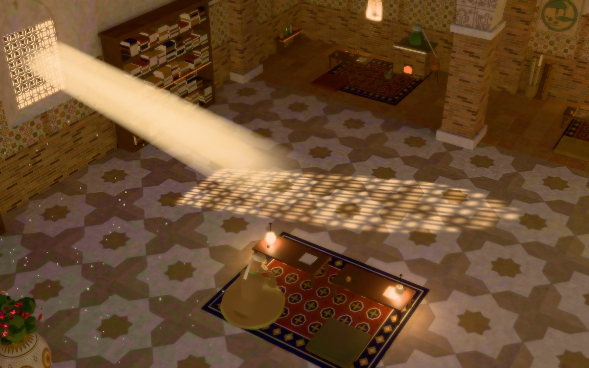
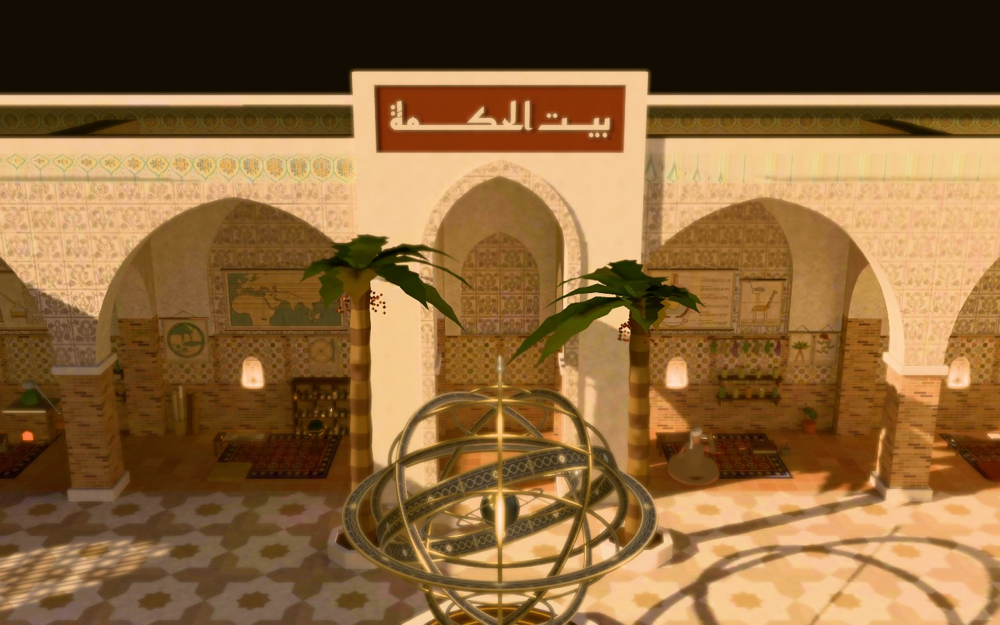
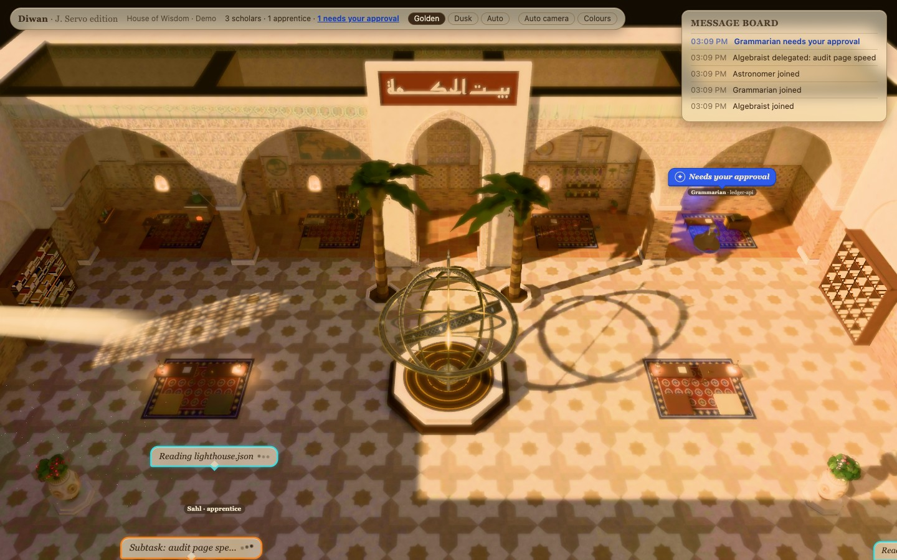
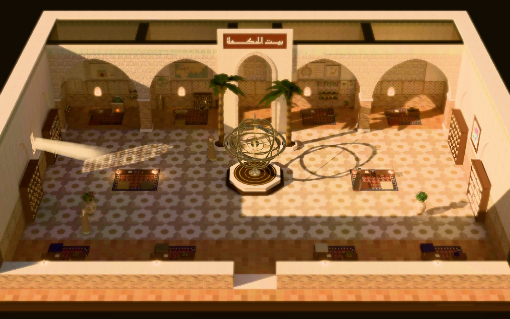
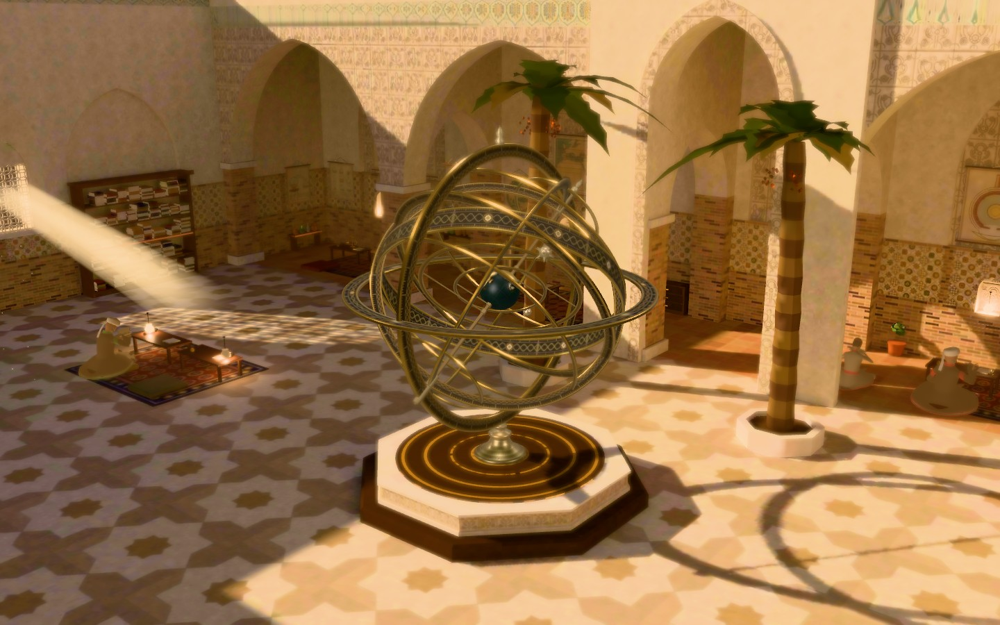

# Diwan M1: House of Wisdom, results

The baked House of Wisdom hall (Baghdad, 9th century) with skinned scholar figures, the agent
grammar, the on-screen message board, three themed north chambers, idle life, mood and a camera
director. (The in-world notice board is off for now, at Yousef's request on 2026-10-15: it was too
small to read. `world.board` brings it back.) This page holds the
look-dev frames, the performance numbers and how to reproduce both.

## Look-dev frames (1440x900)

Rendered by `webview-3d/e2e/frames.spec.ts` (`npm --workspace webview-3d run frames`); images live
in `docs/superpowers/m1/img/`.

**1. Golden hour, wide.** The default camera: the whole hall as a miniature, sun grille patch on the
floor, the armillary sphere on its octagonal plinth between the palms, eight alcoves, the Kufic
name band over the north arch. Three of the four north chambers are themed (Yousef, 2026-10-15),
west to east: a chemistry lab (an alembic on a brick furnace with an ember glow, retorts, jars),
a cartographer's room (the al-Khwarizmi world map with its seven climates, a south-up Balkhi disc,
Baghdad's round city, a globe and a rack of rolled maps) and a biology lab (Hunayn's eye, al-Jahiz's
animals, Dioscorides' plants, drying herbs, specimen jars, a plant press); the fourth stays the
scholar's study. The wall art is drawn in code, with no text and no pseudo-script. The palms stand
still; only their fronds move, slightly.

**2. Dusk, wide.** The lantern-lit mood: cool blue stone and floor, warm practicals in the alcoves
and along the south wall.

**3. Alcove A/B.** The same seat idle (A, left) and asking for approval (B, right): the cobalt
glaze lamp lights and the on-screen message board gains a line.

| A: idle                                       | B: needs your approval                                |
| --------------------------------------------- | ----------------------------------------------------- |
|  |  |

**4. The gobo signature shot.** Sun through the pierced stucco window grille: a shaft, a projected
pattern on the floor, and dust motes.

**5. Materials.** Samarra bevelled stucco, baked brick, glazed tile band, and the Reem Kufi
name band بيت الحكمة.

**6. UI.** Speech bubbles with kind-coloured borders (working kinds, cobalt for approval, calm for
waiting) and the compact apprentice tag ("Hunayn · apprentice"). The on-screen message board
carries the feed.

**7. Idle life.** About 37 s into `?demo=1&demoSpeed=1&director=0`: scholars away from their
seats, one in the sun shaft and one at a south alcove.

**8. The armillary sphere.** The courtyard's centrepiece, which replaced the fountain at Yousef's
request on 2026-10-12: a 3.6 m bronze-and-brass instrument on a two-tier octagonal plinth (dark
wood base, carved Samarra stucco frieze, a dark top inlaid with brass rings). The meridian and the
broad horizon brim are fixed; the polar axis rises 33.3 deg (Baghdad) above the north horizon.
The celestial cage (equator, colures, tropics, polar circles and the 23.44 deg zodiac belt) turns
westward once every 100 s, a gilt sun runs along the ecliptic (300 s) and a silver moon on its
own ring 5.15 deg off it (40 s); the gilt-continent Earth (the Old World only, Baghdad at the
zenith) stays still at the centre. Degree scales, interlace and rosette bands, no script.

## Performance

Headless Chromium on ANGLE-on-Metal (Apple M-series), 1440x900, demo playing, `?bench=1` (every
frame rendered, frame-rate limit and vsync off), 12 s per tier after a 2 s warm-up. Budget:
frame time <= 8 ms.

| Tier     | Frames | Median ms | p95 ms | Budget  | Result |
| -------- | ------ | --------- | ------ | ------- | ------ |
| high     | 3735   | 3.10      | 5.30   | <= 8 ms | within |
| balanced | 3723   | 3.20      | 5.60   | <= 8 ms | within |

The low tier turns off tilt-shift, bloom, shafts and motes and is not part of the budget table
(a 2 s smoke run measured median 3.0 ms, p95 5.1 ms).
Measured 2026-10-15, after the themed chambers (an earlier run on a busy machine read p95
10.1 / 12.2 ms; the re-run on a quiet one is the table). With the inspect card open (`-- --card`):
high 2.9 / 4.9 ms, balanced 2.8 / 3.9 ms.
Sizes: hall GLB 6.2 MB + two lightmaps 1.2 MB + gobo 0.2 MB + armillary GLB 0.4 MB = 8.0 MB against
the 12 MB budget; figures GLB 0.6 MB against 3 MB.

## How to run

All commands from the repo root; `webview-3d` is an npm workspace.

- **Demo** (no server needed): `npm --workspace webview-3d run dev -- --port 5180`, then open
  `http://localhost:5180/?demo=1`. Useful params: `demoSpeed=2` (up to 20), `mood=golden|dusk|auto`,
  `quality=low|balanced|high`, `director=0|1`, `bench=1` (render every frame), `frames=1` (enables
  the camera and approval-lamp probes in a production build).
- **Live** (reads real Claude Code agents): start a standalone pixel-agents server
  (`npx pixel-agents --port 3100`; if your server uses another port, set `DIWAN_SERVER_PORT`),
  then `npm --workspace webview-3d run dev -- --port 5180` and open `http://localhost:5180/`.
  See `webview-3d/README.md`.
- **Tests**: `npm --workspace webview-3d run typecheck`, `npm --workspace webview-3d test`,
  `npm --workspace webview-3d run build`.
- **End-to-end**: `npm --workspace webview-3d run e2e` builds, serves and runs Playwright (the
  default run; `@frames` is excluded). It checks the hall loads, 3+ figures render, the on-screen
  message board carries the feed and no in-world board mounts (the House of Wisdom has none for
  now), the approval lamp reads cobalt on screen after post, and the console is clean.
- **Frames**: `npm --workspace webview-3d run frames` writes the images above (about 1.5 min).
- **Perf**: `npm --workspace webview-3d run perf` builds, serves and prints JSON plus a table.
  `-- --url <url>` measures a running build; `-- --seconds 20` samples longer; `-- --tiers high`.
- **Assets**: `npm --workspace webview-3d run assets` re-exports the layout, bakes the hall and
  lightmaps in headless Blender (`BLENDER=/path/to/Blender` to override the default macOS path)
  and optimises the GLBs. See `webview-3d/assets/README.md`.

On a Mac, Playwright and `perf.mjs` launch Chromium with ANGLE-on-Metal. Without a GPU, headless
Chromium falls back to software GL and a single frame takes seconds.

## What is in the world

**Grammar mapping.** The eight spec §4 signals, all driven by the unchanged upstream engine:

| Signal                          | In the hall                                                                             |
| ------------------------------- | --------------------------------------------------------------------------------------- |
| Workstation lit when active     | Desk, lamp and candles at the scholar's alcove seat                                     |
| Kind of work                    | Bubble border and swatch colour per tool kind (read, write, run, search, web, delegate) |
| Prop or animation per kind      | Clips and props: read, write, scroll search, astrolabe, receive letter                  |
| Subagent arrives, works, leaves | An apprentice appears with an ink-dissolve, wears a compact tag, dissolves out          |
| Needs your approval             | Cobalt-glaze lamp and bubble, a line on the message board                               |
| Done, waiting for you           | Calm bubble with "Done, waiting"                                                        |
| Idle wandering                  | Idle director (below)                                                                   |
| Context fullness                | A gauge on the figure (a candle's wax) and under the tag, once real usage arrives       |

**Personas.** Main agents get stable titles from the world's roster by hashing their id (Astronomer,
Geometer, Translator, Physician, Librarian, Mapmaker, and so on; a numeral is added when the roster runs out). Apprentices take given names (Yahya, Ishaq,
Hunayn, Jabir, ...). The HUD counts "3 scholars · 1 apprentice · 1 needs your approval".

**Board voice.** Feed events can be rewritten in the world's voice ("Mapmaker requests your
seal"-style lines) for an in-world board: a canvas texture mapped onto the hall's `notice_board`
panel. The House of Wisdom has no in-world board for now (`world.board` is null, so nothing mounts
or bakes); the on-screen message board shows the plain text.

**Idle life.** After about 6 s idle, scholars walk to points of interest (shelves to read or search
scrolls, the armillary sphere to look up at it, a planter, a pairwise conversation; the notice
board too, in a world that has one), stay 8 to 20 s,
and return to their seat after three outings. At most two scholars per spot.

**Mood.** Golden hour by default; dusk is a second baked lightmap and set of practicals. The
Golden / Dusk / Auto toggle switches manually; Auto fades to dusk after 20 s with no active agent.
The cross-fade is a smoothstep-eased mix of the two baked lightmaps.

**Auto camera (director).** The Auto camera toggle (on by default in demo mode, off in live mode; `director=0|1` overrides)
picks the next shot by priority (approval, delegate, done, join), holds each at least 4 s, and
returns to the wide shot after 8 s of silence. Clicking an agent glides the camera and the
tilt-shift focus to it.

## Known gaps

- **The approval lamp is small at the default camera; the bubble and the cobalt light pool carry
  the signal there.** The lamp is a runtime glass mosque lamp (cobalt glaze, fresnel edge) with a
  cobalt glow, a floor pool and, in alcoves, a wall pool; the scholar beckons. Measured lamp core in
  the demo e2e: hue 227–233°, saturation 0.67–0.80, value 0.94–0.95. On the orange rugs the
  additive pool reads violet-blue. The back palms' fronds were pruned on their alcove side
  (2026-10-15), so no north lamp hides behind a frond at the default camera any more.
- **The in-world board is off for now.** Its lines were not legible at the wide and UI poses
  (Yousef, 2026-10-15); the on-screen message board carries the feed.
- **Figures are stylised figurines** (a robe bell, simple head and hands), not detailed characters.
- **Headless perf proxy.** The headless run pins device pixel ratio to 1, so the high tier's 2x
  supersampling is not exercised; frame deltas with uncapped vsync are a proxy for GPU time.
- **Fonts are macOS system fonts, rendered output only** (see below).
- **Dependencies**: `meshoptimizer` and `@gltf-transform/*` are used by the asset pipeline but are
  declared only via hoisting; a lockfile change is batched for M1 close.
- Art-direction review findings: tracked in the task ledger, not repeated here.

## Arabic verification

Every Arabic string in the hall (Kufic band, board voice) is listed in
[`../arabic-strings.md`](../arabic-strings.md) for Yousef to verify before client delivery.

## Font note

The Arabic name band is Reem Kufi (SIL OFL 1.1, vendored in `webview-3d/assets/fonts/`), rendered once
to an image and traced into the hall's geometry; no font file is loaded at runtime. The in-world board
canvas (when a world has one), the HUD and the bubbles are drawn at runtime with CSS and system
fonts. The chambers' wall art carries no writing at all: ruled bars stand in for text.
