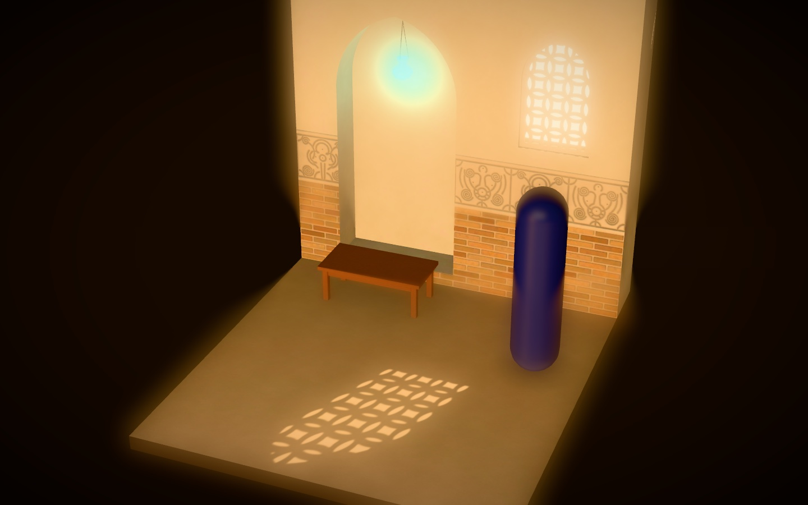
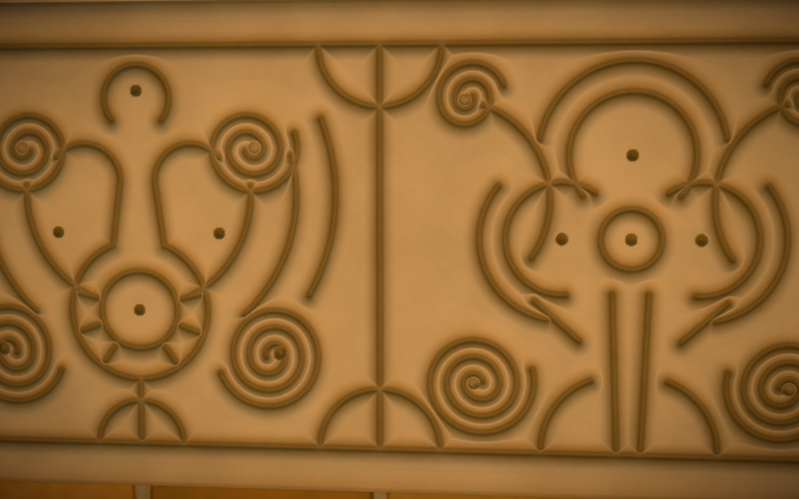
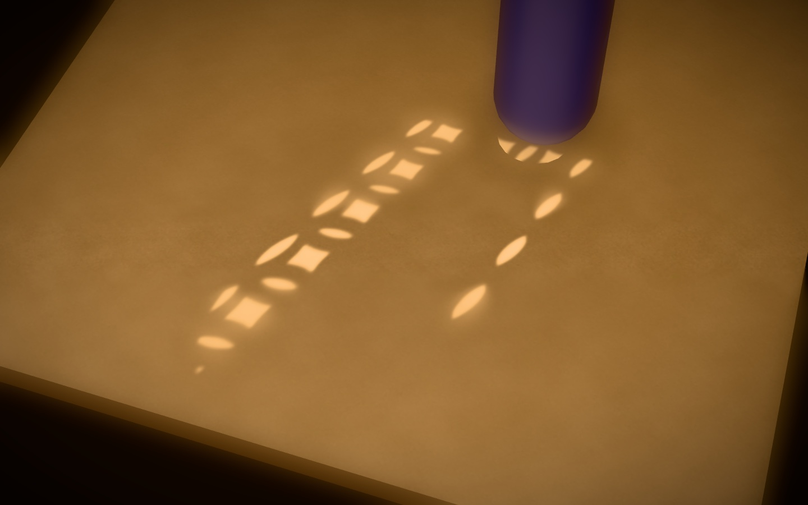
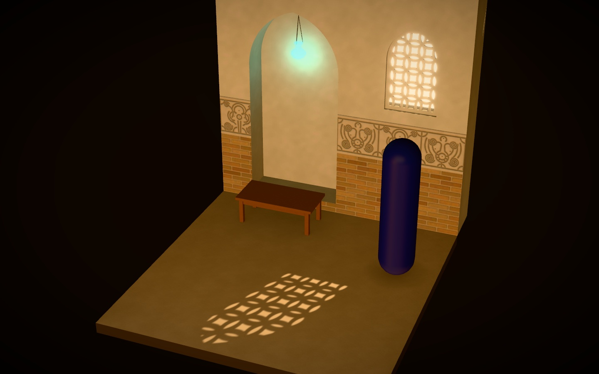
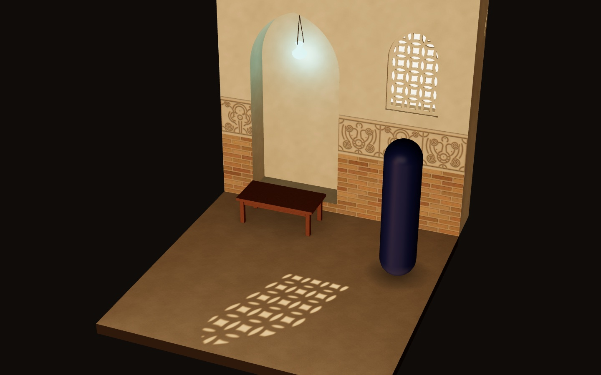

# Spike: the M1 asset pipeline (headless Blender → gltf-transform → R3F)

**Date:** 2026-10-12 · **Branch:** `spike/m1-pipeline` · **Status:** answered
**Question:** can we produce the hero world's look with this pipeline, at good quality and a sane cost?
**Scope:** one 3 m × 3.2 m beauty corner of the House of Wisdom. Everything under `spikes/m1-pipeline/` and `webview-3d/src/spike/` is throwaway.

## Answer

**Yes.** Every stage works on this Mac with no external downloads.

- Headless Blender 5.2.2 generates the Samarra bevelled stucco, the baked brick, the pointed-arch niche and the pierced grille from code.
- Cycles bakes on the M5 GPU through Metal. A normal bake takes about 1 s, AO about 2.5 s, and each 1024² lightmap pass at 512 spp takes 15 to 18 s.
- gltf-transform 4.5.1 turns an 8.07 MB GLB into 3.72 MB with KTX2 (9.3 MB of VRAM) or 0.53 MB with WebP (56 MB of VRAM).
- R3F renders the lit, graded frame. That means lightmap on `uv1`, gobo `SpotLight.map`, golden key, 22° lens, tilt-shift, bloom on emissives only, and the turquoise lamp.
- That frame costs about 2.5 ms of GPU-synchronised frame time at 1440×900, and about 5 ms at Retina (2880×1800). That's an order of magnitude inside the spec's 50 fps budget.
- The whole pipeline reruns in 50 s warm.

Cost is not a risk. The open items are:

- the art direction of the bake, which is flat on the upper wall
- the motif library's authenticity
- lighting and grounding for live figures
- a measurement on a mid-range laptop

## Evidence

| Frame                                                                            | What it shows                                                                                                                                                                                                                |
| -------------------------------------------------------------------------------- | ---------------------------------------------------------------------------------------------------------------------------------------------------------------------------------------------------------------------------- |
|                                      | **Beauty corner at the 22° camera with tilt-shift**: KTX2 GLB with the ETC1S lightmap, golden key, emissive-only bloom on the window and the turquoise lamp, warm LUT, vignette                                              |
|                                              | **Stucco close-up** (tilt-shift off): the baked normal and AO trim at 2048 px/m under lightmap and environment light only                                                                                                    |
|                                                    | **Gobo on the floor**: interlaced-circle grille, projected through the splayed reveal, with a soft penumbra. The figure stands in the beam, so its shadow-map shadow cuts the pattern and its base catches pattern fragments |
|   | The same frame without tilt-shift, and without post-processing entirely (R3F's default ACES, no bloom). Compare the window glow and the lamp                                                                                 |

## 1. Stage by stage

All commands run from the repo root.

| Stage                                      | Result                                   | Script / command                                                                                                                                          |
| ------------------------------------------ | ---------------------------------------- | --------------------------------------------------------------------------------------------------------------------------------------------------------- |
| Patterns as numpy fields                   | Works                                    | `spikes/m1-pipeline/blender/patterns.py`: stucco, brick, plaster, cedar, pointed arch, grille, marching squares                                           |
| High-poly relief + Cycles high→low bake    | Works                                    | `Blender -b --factory-startup --python-exit-code 1 --python spikes/m1-pipeline/blender/trim_bake.py`                                                      |
| Low-poly corner, UV1, lightmaps, gobo, GLB | Works                                    | `… --python spikes/m1-pipeline/blender/scene_bake_export.py`                                                                                              |
| gltf-transform, Meshopt + KTX2 / WebP      | Works, with two flags that are mandatory | `sh spikes/m1-pipeline/optimize.sh [default\|tuned\|webp\|lightmap\|all]`                                                                                 |
| R3F render                                 | Works                                    | dev: `npm --workspace webview-3d run dev -- --port 5190`, then open `/spike.html`. Build: `cd webview-3d && npx vite build --config vite.spike.config.ts` |
| Measurement                                | Works                                    | `node spikes/m1-pipeline/shot.cjs "<url>" <out.png\|-> <waitMs> gpu 1`, with `?bench=raf` or `?bench=gpu`                                                 |

**Generation (`trim_bake.py`).**

- **Stucco:** two mould units, a bottle with winged volutes and a trilobed palmette, built as compass constructions. The groove network is made of arcs, segments and two-centre spirals; the height profile is a slanted bevel rounding into the top, plus pillowing so no flat ground is left, plus drilled eyes.
- **Brick:** buff Abbasid baked brick in running bond, with per-brick firing variation, chipped edges and recessed gypsum joints.
- **High poly:** each pattern is displaced into a padded grid so the bake tiles.
- **Bake:** NORMAL (tangent space) and AO are baked selected-to-active onto a flat trim plane. Plaster, floor and cedar take the numpy-only path, from height straight to normal and colour, with no Blender bake.

**Scene (`scene_bake_export.py`).**

- **Wall:** a box bisected at the dado and band heights, then cut with the MANIFOLD Boolean by a niche prism and a lofted, splayed window.
- **Materials:** reassigned by face rule, UV0 projected per material, and hidden faces deleted.
- **Props:** the desk (bevelled), the lamp (spun profile with three rods) and the grille.
- **Grille:** marching squares on the same SDF that drives the gobo, then `tessellate_polygon` with holes, extruded to a 2.5 cm slab.
- **Join and unwrap:** everything is joined into one mesh with eight materials, and `smart_project` plus `pack_islands` lay a second UV set, `UVLightmap`.
- **Lightmap bakes:** three DIFFUSE passes into a 1024² float image, through bake-only ceiling and side walls:
  - A: sky and courtyard, direct plus indirect, sun off
  - B: indirect only from the sun
  - C: direct only from the sun, used for calibration and as a fully baked low-tier fallback
- **Shipped lightmap:** A+B. The sun's direct part comes from the live gobo spot.
- **Gobo:** ray-cast in numpy from the spot's exact three.js projection frame, through the reveal, the splay and both faces of the grille slab, then blurred by the sun disc's penumbra.
- **Export:** the GLB plus `corner.meta.json`, which holds the light parameters in three.js coordinates and is also stored in node extras.

**Stage 4 (`optimize.sh`).** The `tuned` variant is what ships here:

1. `optimize` for geometry only (`--compress false --texture-compress false --simplify false --prune-attributes false`)
2. `uastc` on `normalTexture`
3. `etc1s` on `{baseColorTexture,occlusionTexture}`
4. `meshopt`

The lightmap ships outside the GLB, one file per mood, via `ktx create --format R8G8B8_SRGB --encode basis-lz` (or `uastc`).

**Render (`webview-3d/src/spike/`).**

- **Loaders:** `GLTFLoader` from three's examples, with `KTX2Loader().detectSupport(gl)` and `MeshoptDecoder`. drei's `useGLTF`/`useKTX2` are bypassed (see gotchas).
- **Lighting:**
  - the lightmap on every material (`channel = 1`)
  - the gobo `SpotLight` built from the meta file
  - drei `<Environment>` with three `<Lightformer>`s for the live figure and speculars
  - an emissive card behind the window
  - a turquoise point light pulsing with the glaze
- **Post-processing:** `Bloom` (threshold 1.0, mipmap blur), `TiltShift`, `ToneMapping` (NEUTRAL), `LUT` (procedural warm grade) and `Vignette`.
- **URL parameters:** `shot`, `tex`, `lm`, `post`, `tilt`, `dpr`, `exp`, `amb`, `tm`, `phase` and `bench`.

## 2. Numbers

**Blender, warm (Metal kernels cached), Apple M5 10-core GPU:**

| Step                                                                               | Time                 |
| ---------------------------------------------------------------------------------- | -------------------- |
| Stucco fields + colour, numpy (2048×1024)                                          | 1.84 s               |
| Stucco high-poly build (691,200 tris)                                              | 0.33 s               |
| Stucco normal bake 2048×1024, 8 spp                                                | 1.18 s               |
| Stucco AO bake 2048×1024, 256 spp                                                  | 2.48 s               |
| Brick high-poly (583,200 tris) / normal 1024² / AO 1024² @256                      | 0.28 / 0.46 / 1.36 s |
| Low-poly corner generation (Booleans, grille, desk, lamp)                          | 0.25 s               |
| Lightmap UV unwrap + pack                                                          | 1.71 s               |
| Lightmap bakes 1024² @512 spp: A sky / B sun bounce / C sun direct                 | 14.8 / 17.6 / 2.6 s  |
| Gobo projection (numpy, 1024²) / GLB export                                        | 0.20 / 0.11 s        |
| **End to end** (trim 11 s + scene 35 s + optimise 4 s, including Blender start-up) | **50 s**             |
| One-off Metal kernel compile on a machine's first Cycles GPU run                   | ~114 s, once         |

**Geometry:**

- High poly: 691,200 triangles for the stucco and 583,200 for the brick. These are bake sources only and never ship.
- Low poly: 6,319 triangles in total. That's 543 for the wall, 8 for the floor, 756 for the desk, 504 for the lamp, 60 for the rods and 4,448 for the grille (55 piercings).
- The frame renders 8,467 triangles in 41 draw calls with post-processing, or 13 draw calls without.

**Textures:**

| Map                   | Resolution              | Texel density      | Path                             |
| --------------------- | ----------------------- | ------------------ | -------------------------------- |
| Stucco trim           | 2048×1024               | 2048 px/m          | Cycles normal + AO, numpy colour |
| Brick                 | 1024²                   | 1024 px/m          | Cycles normal + AO, numpy colour |
| Plaster, floor, cedar | 512²                    | 512 px/m           | numpy only                       |
| Lightmap              | 1024² (one atlas)       | about 5–7 mm/texel | Cycles, three passes             |
| Gobo                  | 1024², grey PNG (90 KB) | n/a                | numpy ray cast                   |

**Sizes:**

| Artefact                                                   | Size                      | Encode time | VRAM (gltf-transform estimate) |
| ---------------------------------------------------------- | ------------------------- | ----------- | ------------------------------ |
| Raw GLB from Blender (PNG textures)                        | 8.07 MB                   | n/a         | n/a                            |
| `optimize --texture-compress ktx2` one-liner               | 5.03 MB                   | **116 s**   | about 11 MB                    |
| **Tuned KTX2** (UASTC normals, ETC1S colour + AO, Meshopt) | **3.72 MB**               | **3 s**     | **9.3 MB**                     |
| WebP (`optimize --texture-compress webp`)                  | **0.53 MB**               | 0.35 s      | **56 MB**                      |
| Lightmap: PNG / UASTC+zstd / ETC1S                         | 1.56 / 0.99 / **0.17 MB** | under 1 s   | 1024² compressed               |

The three UASTC normal maps are about 3.0 MB of the 3.72 MB KTX2 GLB.

**Quality** (PSNR of the 1440×900 frame against the reference frame):

- ETC1S lightmap against UASTC: **53.6 dB** (max 6/255), so ETC1S it is.
- WebP textures against KTX2: 45.3 dB on both the beauty and the stucco frames.
- Normals computed in numpy against the Cycles bake: 31.9 dB. The differences sit at groove edges and drilled eyes (max 119/255), where the bake's anti-aliasing wins.

**Browser frame cost:**

- **Setup:** Playwright Chromium, headless, on ANGLE Metal ("Apple M5"); production build; viewport 1440×900; full post stack.
- **rAF sampling** (6 s after a 2.5 s warm-up, 721 frames): **120 fps**, the vsync cap, at both dpr 1 and dpr 2. p95 is 8.9 ms and the maximum 9.5 ms.
- **Uncapped, GPU-synchronised burst** (120 × `advance()` + `readPixels`), median of three runs:

| Configuration                | ms/frame      | Uncapped fps |
| ---------------------------- | ------------- | ------------ |
| dpr 1 (1440×900), full post  | 2.5 (2.3–3.0) | about 400    |
| dpr 2 (2880×1800), full post | 5.1 (4.4–5.5) | about 195    |
| dpr 2, no tilt-shift         | 4.1           | about 245    |
| dpr 2, no post-processing    | 2.4           | about 415    |

So the post stack costs about 2.7 ms at Retina, about 1.0 ms of it tilt-shift. KTX2 against WebP makes no measurable difference to frame time; VRAM and upload are where they differ. Asset load and decode takes 90–145 ms warm, and about 530 ms on the first load (transcoder start-up).

## 3. Gotchas

**gltf-transform 4.5.1**

1. **`optimize` deletes the lightmap UV set.** `--prune-attributes` defaults to true, and TEXCOORD_1 is referenced by no glTF material, because the lightmap ships outside the GLB. Always pass `--prune-attributes false`. After the fix, UV1 is quantised to u16; tiling TEXCOORD_0 stays f32 ("out of [0,1] range").
2. **`optimize` simplifies by default** (`--simplify true`). Pass `--simplify false`, or it rewrites hand-built and lightmapped geometry.
3. **`--texture-compress ktx2` is slow and a blunt tool.** It took 116 s here and puts UASTC on AO. The explicit `uastc` / `etc1s` / `meshopt` chain takes 3 s and gives a smaller file.
4. **RDO is skipped on normal maps by design.** The code reads `if (rdo && !isNormalMap)`. With `ktx create --uastc-rdo --uastc-rdo-l 0.5` directly, the stucco normal drops from 1.82 to 1.25 MB (−31%). Doing that inside the GLB needs a small `@gltf-transform/core` script.

**three 0.185**

5. **Lightmap on `uv1`.** GLTFLoader maps TEXCOORD_1 to the `uv1` attribute; set `lightMap.channel = 1`. A PNG lightmap also needs `flipY = false` and `colorSpace = SRGBColorSpace`. A KTX2 lightmap gets both from the file: KTX2 is never flipped, and the transfer function comes from the DFD (`--format R8G8B8_SRGB`).
6. **Lightmap units.** `lightMapIntensity × texel` is added as irradiance, and diffuse = irradiance × albedo/π. Cycles' DIFFUSE light bake stores E/π: measured 0.309 against 1/π = 0.318. So `lightMapIntensity = π × M`, where M is the normalisation scale. The live sun spot intensity equals the Blender sun strength: calibrated 3.88 for a strength of 4.0. That is what keeps baked and live light in balance.
7. **`aoMap` scales the lightmap too.** It multiplies all of the indirect diffuse. Keep large-scale occlusion in the lightmap and only the relief-scale AO in the trim sheet (UV0, glTF `occlusionTexture`), or occlusion is applied twice.
8. **`spotLight.map` works without `castShadow` in r185.** The "disabled if castShadow is false" warning in `SpotLight.js` is stale (see `WebGLLights.js` and `shadowmap_vertex`).
   - The map uses the shadow camera's projection: fov = 2·angle, aspect = the shadow map's aspect, and `lookAt` with world +Y up. Generate the gobo in that exact frame and it matches the grille.
   - The texture's row 0 is the top (default `flipY`), and it is linear data (`NoColorSpace`).
   - Keep `penumbra > 0`, because smoothstep with equal edges is undefined.
9. **Gobo and shadow map.** The gobo already encodes the window aperture, and a 1024² shadow map can't resolve 3 cm piercings anyway. So walls and the grille don't cast shadows; only the desk, lamp and figures do, which keeps the shadow pass cheap. Figures standing in the beam correctly receive the pattern and cut it with their own shadow.
10. **KTX2Loader transcoder under Vite: do nothing.** With no `setTranscoderPath`, r185 resolves `basis_transcoder.js/.wasm` through `new URL('../libs/basis/…', import.meta.url)`. Vite serves them in dev and emits them in build (527 KB WASM, 249 KB gzipped). There's no `public/` copy and no CDN.
11. **Meshopt decoder.** `three/examples/jsm/libs/meshopt_decoder.module.js` embeds its WASM, so there's no fetch.
12. **drei's loaders fetch from CDNs by default.** `useGLTF(path)` defaults to Draco from `www.gstatic.com`, and `useKTX2` defaults to a transcoder on `cdn.jsdelivr.net`. Use three's `GLTFLoader` directly, or pass `useDraco=false` and our own KTX2Loader through `extendLoader`. drei's `<Environment>` with only `<Lightformer>` children fetches nothing.

**@react-three/postprocessing 3.2 / postprocessing 6.39.5**

13. **Tilt-shift naming.** `<TiltShift>` is postprocessing's `TiltShiftEffect` (offset, rotation, focusArea, feather, kernelSize). `<TiltShift2>` is a separate glfx-style effect (blur, taper, start, end, samples). This spike uses `<TiltShift>`.
14. **`EffectComposer` forces `gl.toneMapping = NoToneMapping`** while it is mounted, so a `<ToneMapping>` effect is mandatory. Its defaults are a HalfFloat buffer (HDR for bloom) and multisampling 4, so leave the canvas's `antialias` off.
15. **Tone mapper versus the approval colour.** AgX and ACES push the turquoise lamp towards white. Khronos **NEUTRAL** keeps it turquoise, so use NEUTRAL; turquoise is the "needs you" signal.
16. **Bloom on emissives only** is a calibration problem, not a selection pass. With physically calibrated lights, lit surfaces stay below 1.0 in linear (the sun patch is about 0.55), and emissives (lamp, window card) are pushed above it, with `luminanceThreshold = 1.0`. No `SelectiveBloom` is needed.

**R3F 9.8**

17. **`useFrame` with a positive priority takes over rendering.** Use a negative priority for probes, and set `gl.info.autoReset = false` to count every pass.
18. **Two deprecation warnings appear at runtime.** `THREE.Clock` comes from R3F's internals. `PCFSoftShadowMap` is deprecated and comes from `<Canvas shadows>`'s default, so pick a shadow type explicitly in M1.

**Blender 5.2**

19. `Material.use_nodes` and `World.use_nodes` are deprecated, because node trees always exist. `MeshPolygon.loop_total` is read-only: set only `loop_start` when building meshes from numpy. Use `Mesh.shade_smooth()` and `Mesh.set_sharp_from_angle()` in place of auto-smooth.
20. The `MANIFOLD` Boolean solver is fast and reliable, but needs closed cutters. The bake target is the active Image Texture node in every material, and `bake(uv_layer='UVLightmap')` selects the lightmap UVs.
21. AO bake distance comes from `world.light_settings.distance`. `read_factory_settings()` resets preferences, so re-enable Metal after every reset. `bpy.types.CyclesRenderSettings` isn't exposed; inspect via `scene.cycles.bl_rna`.
22. To export glTF occlusion, add a node group named `glTF Material Output` with an `Occlusion` input, created through `node_groups.new(...).interface.new_socket`.
23. The first Cycles GPU run on a machine compiles Metal kernels: about 114 s, once. Budget for it in CI or on a clean Mac.

**Art and history**

24. A 5 cm grille slab at a 40° sun cuts the piercings to slivers, which is physically right but unreadable. A 2.5 cm slab with 16 cm cells reads clearly. Grille depth and sun angle are design parameters, not just modelling details.
25. The grille is interlaced circles, as in Umayyad and Abbasid pierced stucco and stone window grilles. There is no turned-wood mashrabiya.

## 4. Recommendation for the M1 plan

**Pipeline shape.** Promote these scripts, cleaned, into `webview-3d/assets/` (Python under `blender/`) and add three npm scripts:

- `assets:bake`: `blender -b --factory-startup --python-exit-code 1 --python …/trim_bake.py`, then `…/world_bake.py`. It takes about 1 minute per world for each mood.
- `assets:optimize`: the tuned chain from `optimize.sh`, always with `--simplify false --prune-attributes false`. Normals go to UASTC (with RDO from a small `@gltf-transform/core` script, about −30%), colour and AO to ETC1S, then Meshopt. Lightmaps go through `ktx create` to ETC1S, one file per mood.
- `assets`: both of the above.

Commit the optimised outputs, never the raw bakes. Import them through `?url` or `import.meta.glob`, so Vite fingerprints them and three's own `KTX2Loader` and `MeshoptDecoder` are used, with no CDNs. Keep each world's light rig in a `*.meta.json` written by the bake (positions, angle, calibrated intensities) rather than hand-tuned constants.

**Procedural, baked and live:**

- **Procedural in numpy (no Blender):**
  - every pattern field and colour map
  - plaster, floor and wood tiles
  - the gobo (ray-cast in the spot's frame, through the real reveal and grille)
  - Kufic bands
  - normals for soft relief such as plaster
- **Baked in Cycles:**
  - normal and AO for sharp relief (stucco, brick, Kufic, anything with undercuts): about 1–3 s per trim
  - lightmaps per mood: A sky + B sun bounce, plus C sun direct for calibration and the low-tier fallback
- **Live:**
  - the sun's direct light: the gobo spot, the signature shot
  - approval glow and pulse; lamp flicker
  - ink-dissolve spawn and despawn; water, fabric and palm sway
  - tilt-shift focus glide
  - the golden-to-dusk cross-fade: two lightmaps blended by one uniform through `onBeforeCompile`, plus the spot's intensity

Trim sheets are shared across the hall, so texture bytes stay flat as the world grows. What grows is lightmap area: about 0.17 MB per 1024² in ETC1S.

**Look-development frames (start of M1):**

1. The hero wide at the 22° camera with tilt-shift, golden mood: the courtyard arcade, three or four seats, and real CC0 figures in robes.
2. The same wide at dusk, to approve the cross-fade end point.
3. An alcove A/B pair: a scholar at the desk with the lamp idle, then with the turquoise "needs your approval" lamp and its bubble.
4. The signature shot: the gobo through the grille onto the floor, with shafts and dust motes.
5. A material sign-off close-up of the stucco, brick and Kufic band in raking light.
6. A UI frame: the frosted speech bubbles and the in-world message board, lit by the scene.

**Bake direction to fix in look-dev:**

- The upper wall reads flat and hot, because the open courtyard side floods it.
- Bake with the real arcade piers as occluders. That breaks the courtyard light into arch-shaped pools.
- Lower the sky term relative to the sun.

## 5. Risks still open

- **Mid-range laptop:** not measured. The spec target is 30 fps at balanced quality on Intel or AMD integrated graphics; measure the full hall there with tilt-shift and bloom at half resolution.
- **Live figures in a lightmapped world:**
  - They get no baked light and no contact shadow. Here a hand-matched `<Environment>` and a blob decal stand in.
  - M1 needs baked light probes (spherical harmonics from Blender, or three's `LightProbeGenerator`) and a contact-shadow approach.
  - The figure itself is still §9's open budget decision.
- **Two-mood cross-fade:** three supports one `lightMap` per material, so the blend needs a small shader patch. That is simple, but unbuilt.
- **Motif authenticity:**
  - The stucco is Samarra-like (bevelled, slanted cut, pillowed, drilled eyes) but simplified; the motif library needs a research pass and Yousef's sign-off.
  - Kufic is untried.
- **Download budget:** UASTC normals dominate (3.0 of 3.72 MB here). Levers are RDO on normals (−31%), 1024 px/m outside close-up hero spots, or WebP for the jservo.com demo, at about 6× the VRAM.
- **Full-hall bake time:** this scales with lightmap area. Expect 2048² or several atlases, so roughly 4 × 35 s per mood: minutes, not hours.
- **Static gobo:** the gobo is valid for one sun position. A moving sun needs a re-projected gobo per angle; dusk turns it off or swaps it.
- **Headless benchmark:** the numbers come from headless Chromium on ANGLE Metal. rAF is capped at 120 Hz, and the synchronised burst includes CPU time. Confirm in desktop Chrome on Yousef's display.

## Files

- Scripts:
  - `spikes/m1-pipeline/blender/patterns.py`
  - `spikes/m1-pipeline/blender/bl_common.py`
  - `spikes/m1-pipeline/blender/trim_bake.py`
  - `spikes/m1-pipeline/blender/scene_bake_export.py`
  - `spikes/m1-pipeline/blender/compare_png.py`
  - `spikes/m1-pipeline/optimize.sh`
  - `spikes/m1-pipeline/shot.cjs`
- Committed outputs:
  - `spikes/m1-pipeline/out/corner.webp.glb` (534 KB)
  - `lightmap_golden.etc1s.ktx2` (171 KB)
  - `gobo_window.png` (90 KB)
  - `corner.meta.json`
  - `timings_*.json`
- The repo's root `.gitignore` ignores every `out/` directory, so the committed outputs above were force-added (`git add -f`).
- Regenerated locally, not committed (git-ignored):
  - `corner.ktx2.glb` (3.72 MB; `optimize.sh tuned`)
  - `lightmap_golden.uastc.ktx2` (0.99 MB)
  - `lightmap_golden.png` (1.56 MB)
  - `tex/`: trim maps, 7.5 MB of PNG
  - `raw/`: the raw GLB (8.07 MB), float lightmaps as `.npy`, logs, the `.blend`
- Spike page:
  - `webview-3d/spike.html`
  - `webview-3d/src/spike/{main.tsx,SpikeApp.tsx,assets.ts}`
  - `webview-3d/vite.spike.config.ts`: a new, separate config that builds only `spike.html` into `dist/webview-3d-spike`.
  - `vite.config.ts` is untouched, and the production build is unchanged.
- Package files: `webview-3d/package.json` and `package-lock.json` changed only through the human's installs (`@react-three/postprocessing@3.2.0`, `postprocessing@6.39.5`, `@gltf-transform/cli@4.5.1`).
